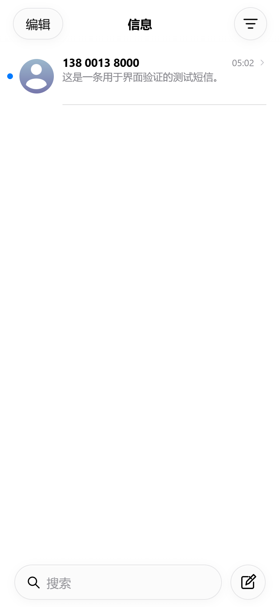
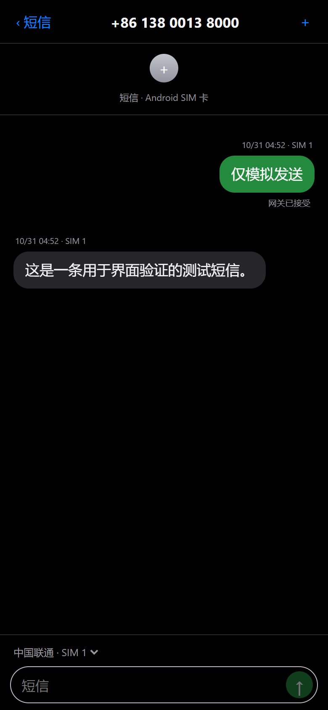

# CommLink · 通讯互联

[中文](README.md) | English

CommLink uses one Android host and independently paired phones to provide SMS, contacts, SIM lines and call history to two iPhone Home Screen apps. Interconnected Messages keeps the original SMS installation. Interconnected Phone connects to a separately authorised HTTPS listener. Optional voice requires a verified cellular Voice SIP Agent, an Asterisk PBX and Groundwire.

**Current version 0.9.1 (53)** retains the application ID and signing chain of SMS Connect Assistant 0.8.9 (23). It can upgrade an existing installation with the same package ID and signature; fresh installations still require setup. See the [upgrade and validation guide](docs/COMMLINK-UPGRADE.md), [multi-device guide](docs/MULTI_PHONE.md), [directory guide](docs/COMMLINK-DIRECTORY.md), and [voice guide](docs/VOICE.en.md). The UI is Chinese. This project builds on [Android SMS Gateway](https://github.com/capcom6/android-sms-gateway). See [LICENSE](LICENSE).

[Download APK](https://github.com/1Fann/sms-connect-assistant/releases) · [Installation](docs/INSTALL.en.md) · [Security and privacy](SECURITY.md) · [Contributing](CONTRIBUTING.md)

The Phone PWA launches Groundwire to originate native voice calls, with explicit PBX prefixes selecting the device and SIM. Browser microphone capture, WebRTC and background handoff have been removed. Groundwire owns the call throughout; Android call history continues to sync.

Version 0.9.1 includes the recent startup fixes: one authenticated live response supplies initial SMS and conversation metadata, sender names and SIM aliases are resolved in batches, and the prepared inbox appears directly after the startup screen. Only interface resources are cached; SMS content is not persistently cached. Android code and both PWAs ship in the APK. A fresh installation still requires permissions, trusted HTTPS and pairing; optional voice also requires a separately configured PBX and gateway. See the [0.9.1 release notes](docs/releases/0.9.1.md).

## Features

- One host can pair multiple Android phones. Each device and logical SIM line has its own identity. See [multi-device setup](docs/MULTI_PHONE.md).
- iPhone PWA with message lists, conversations, contact search, dual-SIM selection, sending status, and light/dark themes.
- Refined against a native Messages recording: a centered title, circular swipe actions, centered pins, floating search/compose, and grouped bubbles. Long-press opens a conversation preview with a separate menu; previewing does not mark messages read. Web materials still differ from native rendering.
- Keyboard layout keeps a stable shell while the chat area separately avoids the keyboard. The floating composer removes duplicate bottom safe-area spacing; bottom-following and older-message reading positions are preserved, including multiline input. Viewport simulations pass. The user confirmed on an iPhone that the page stays stable as the keyboard opens/closes and the composer sits above it; other devices and keyboards still need validation.
- Android default SMS app mode handles text messages and system SMS database records. Ordinary operation does not require Root.
- On the tested Redmi / MIUI 14 device, setting the app as the default SMS handler and granting permissions avoids per-message Android confirmation while keeping MIUI optimization enabled. Other ROMs require testing.
- HTTPS, Android-side pairing approval, device revocation, session rotation, and idempotent requests. Unknown outcomes are not automatically resent as new requests; gateway acceptance does not mean delivery.
- Cloudflare DNS-01 certificate issuance and renewal jobs, or manual certificate import. Users maintain their own DDNS.
- iOS Home Screen Web Push with generic alerts by default. Each device can opt into encrypted sender and message previews and tap to open the conversation. Delivery depends on Apple push services and may be delayed.
- Configurable checks every 1–1440 minutes, default 5, covering local HTTPS, certificates, permissions, and IPv6 DNS.
- Optional independent Root watchdog checks cached process identity every second and performs bounded recovery while respecting manual stop. Root is not required for normal SMS operation.
- International number display uses Google libphonenumber / libphonenumber-js numbering rules. These are not Apple's private formatting API and do not guarantee exact matches across all iOS versions.

- Conversation gestures: swipe left to remove, swipe right to mark read/unread, long-press menus, up to nine pinned conversations, bulk removal and recovery. Metadata persists on Android. Removal affects the assistant only; original Android SMS remain intact. Recently Deleted supports recovery without an expiry, and new messages remain visible.
- Hide Alerts: a purple bell beside Delete, with the same control in the long-press menu and contact sheet. State persists on Android and suppresses only the selected conversation’s iPhone push notifications. SMS reception and Android alerts continue. Queued/retried work rechecks mute state; notifications already submitted to Apple cannot be recalled.
- More interactions: edit pins, batch mark unread, full swipe right to toggle read state, long-press bubbles to copy/forward, and drag left to reveal timestamps. Forwarding creates a draft requiring an explicit recipient and send action.
- Motion: interruptible swipe springs, full-page navigation with interactive edge-back, traveling pinned avatars and shifting neighboring rows. Returning preserves inbox scroll, and Reduced Motion is respected. Timestamp dragging updates the display without recalculating the inbox every frame; unchanged polls reuse existing data.

## Quick start

1. Install the APK from Releases. HTTPS functionality requires Android 6+; the optional Root watchdog requires Android 8+ and a compatible Root environment.
2. Open Settings → Configuration checks and recovery (`配置检查与自动恢复`). Select the app as the default SMS handler, grant SMS/SIM/notification permissions, and allow background operation. On MIUI, also check autostart and battery restrictions.
3. Configure your own domain and trusted HTTPS certificate. `sms.example.com` in public source is a placeholder and must be replaced.
4. Point DNS at a reachable address on the phone. The tested deployment uses public IPv6 with TCP 8443 allowed only to the target device; the iPhone network must also support IPv6. Use Cloudflare DNS-only records.
5. Start the service. Open `https://your-domain:8443` in Safari, add it to the Home Screen, launch it there, enter the pairing code, and approve access on Android.
6. For optional Root protection, select Enable/update Root watchdog (`启用 / 更新 Root 守护`) and grant access in the superuser manager. After enabling it in this version, app startup refreshes an enabled guard after APK updates; check both supervisor and monitor process status on this page.

First-install permissions, certificates, and pairing cannot be silently granted by an APK. Updates with the same package ID and signature preserve configuration; uninstalling or reinstalling with a different signature can lose private configuration. Existing iPhone Home Screen icon names may require manual renaming.

## Preview

These screenshots use simulated browser-test data, not personal messages.

 

## Build

Use JDK 17, Android SDK 35, and Build Tools 36.0.0. The Gradle Wrapper uses 8.8. Set `ANDROID_HOME` or put your own `sdk.dir` in an untracked `local.properties` file.

```sh
./gradlew :app:testDebugUnitTest :app:assembleDebug
```

On Windows use `gradlew.bat`. Built web assets are included in the Android source. To change the web interface, use Node 24 and pnpm 11:

```sh
cd pwa
pnpm install --frozen-lockfile
pnpm test
pnpm build
```

For a signed release set `SIGNING_STORE_FILE` (absolute path to your private keystore), `SIGNING_STORE_PASSWORD`, `SIGNING_KEY_ALIAS`, and `SIGNING_KEY_PASSWORD`, then run `:app:assembleRelease`. Signing keys are not included. A differently signed self-built APK cannot update an existing official installation.

## Validation and limitations

A desktop regression with 1,000 messages and a 200-message conversation reduced React commits during 36 timestamp drag moves from 32 to 0. Edge-back cancellation, interrupted gestures, previews, and failed-save rollback are covered. These checks do not measure iPhone frame rates.

- Version 0.7.4 passed a local build, 136 Android unit tests and 7 supervisor script tests. The unchanged frontend retains the previous version's 35 frontend tests and mocked browser validation. Mock tests do not send SMS.
- Earlier versions verified dual-SIM discovery, real SMS sending/receiving, an iPhone test notification, and public IPv6 access on one Redmi / Android 13 / MIUI 14 device. Version 0.3.0 verified Root recovery after force-stop, respecting manual stop, and disabling the watchdog without stopping SMS service. Version 0.3.1 mainly renames the application and removes personal defaults from public source.
- Local HTTPS health does not prove internet reachability or carrier delivery. Non-Root background fallback checks have a 15-minute minimum and may be delayed; they cannot bypass force-stop. Root protection is not a guarantee of permanent availability.
- The certificate job checks daily and attempts renewal within 30 days of expiry. Real expiry-driven renewal, long-term locked-screen operation, watchdog startup after a full reboot, and other ROMs still need validation.
- MMS notifications are retained, but attachments are not downloaded. This is not a full MMS, iMessage, or RCS client.
- SMS is not end-to-end encrypted and carrier charges may apply. Use only phones and numbers you are authorized to control.

## Attribution and license

Upstream package names and internal identifiers are retained for data and update compatibility. See [NOTICE](NOTICE) for the upstream baseline and major dependencies. Source is licensed under [Apache License 2.0](LICENSE); third-party dependencies retain their own licenses.


### Android contacts

The web directory displays Android system contacts. Enable contact sharing and remote editing to create/edit or append a call number on an explicit Android device. The UI waits for Android write acknowledgement. iPhone vCard import and assistant-card merge workflows have been removed. See the [directory guide](docs/COMMLINK-DIRECTORY.md).
