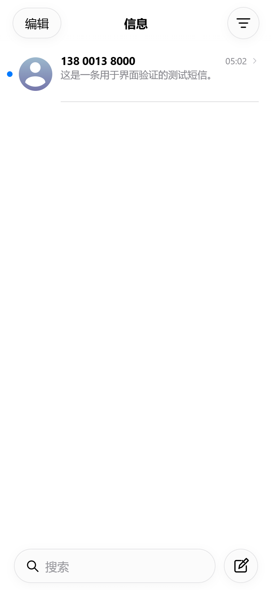
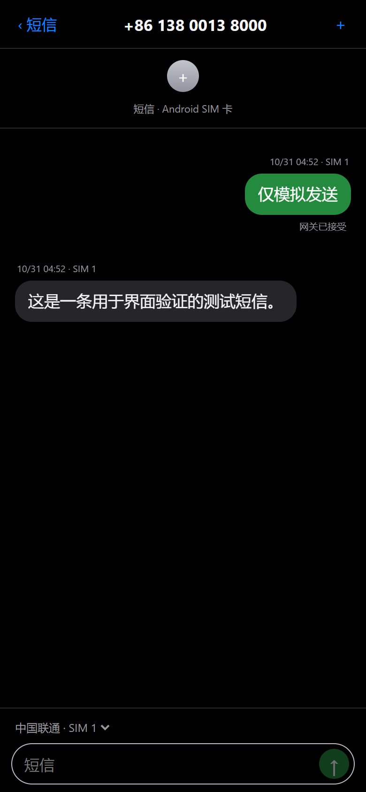

# 短信互联助手 · SMS Connect Assistant

中文 | [English](README.en.md)

让自己的 Android 手机作为短信终端，在 iPhone 的主屏幕网页应用中查看、接收和发送短信。单个 APK 内置 HTTPS 服务和网页，不需要电脑持续运行。

**应用界面保留中文；本仓库提供中英双语文档。** 当前版本为 **0.8.9**，仍需更多机型和长期运行验证。基于 [capcom6/android-sms-gateway](https://github.com/capcom6/android-sms-gateway)，采用 Apache-2.0 许可证；本项目与 Apple、Google、小米及上游项目无隶属关系。

0.8.9 为 iPhone 主屏幕应用加入未读角标。0.8.8 新增加密短信通知预览并改进长按操作。升级保留已有配对和短信记录。[双手机配置](docs/MULTI_PHONE.md) · [中英文更新说明](docs/releases/v0.8.9.md)。

[下载安装包](https://github.com/1Fann/sms-connect-assistant/releases) · [安装说明](docs/INSTALL.zh-CN.md) · [安全与隐私](SECURITY.md) · [贡献指南](CONTRIBUTING.md)

## 功能

- 两部兼容的安卓手机可配对共享，不限品牌：一部作为服务器手机，另一部作为共享手机；iPhone 汇总查看短信，并选择对应手机的 SIM 卡发送。见[双手机配置](docs/MULTI_PHONE.md)。
- iPhone PWA：短信列表、会话、联系人搜索、双 SIM 线路选择、发送状态和深浅色界面。
- 参照原生“信息”录屏调整界面：居中标题、圆形滑动操作、居中置顶头像、底部悬浮搜索和分组气泡。长按展开会话预览与独立菜单，预览不会自动标为已读。网页版材质与系统原生仍有差异。
- 会话手势：左滑删除、右滑已读/未读、长按菜单、最多 9 个置顶会话、批量删除和恢复；状态保存在安卓端。删除仅从助手移除，安卓原始短信保留，“最近删除”可随时恢复，新短信照常显示。
- 隐藏提醒：左滑显示紫色铃铛与删除，长按菜单和联系人详情也可开关。静音状态保存在安卓；只停止此对话的 iPhone 推送，短信和安卓通知仍正常。排队/重试会重新检查状态，已提交到 Apple 的通知无法撤回。
- 更多操作：编辑置顶、批量标未读、向右完整滑动切换已读、气泡长按拷贝/转发、左拖查看时间。转发先生成草稿，由用户选择收件人并发送。
- 动画：可打断的滑动回弹、整页推入与边缘返回、头像置顶移动和相邻行让位。返回保留列表位置，并响应系统“减弱动态效果”。拖动查看时间直接更新画面，不逐帧重算全部短信；相同的轮询结果复用已有数据。
- 键盘布局：页面保持稳定基准高度，聊天区域单独避让键盘；输入栏悬浮在底部，键盘打开时不重复保留安全区。底部阅读与旧消息阅读分别保持位置，多行输入同步调整。视口模拟通过，用户已在 iPhone 上确认键盘展开/收起时页面稳定、输入栏贴住键盘；其他设备和输入法仍需验证。
- 默认短信应用模式：Android 负责文字短信收发及系统短信库记录；普通功能不依赖 Root。
- 在已测试的 Redmi / MIUI 14 上，保持 MIUI 优化开启、设为默认短信应用并正确授权后，iPhone 发送不再要求 Android 逐条确认。其他 ROM 需要实测。
- HTTPS 访问、Android 端配对确认、设备撤销、会话轮换及请求幂等处理。未知发送结果不会自动换新请求重发；“网关已接受”不等于实际送达。
- Cloudflare DNS-01 证书签发与续期任务，也支持手动导入证书。现有 DDNS 由用户维护。
- iOS 主屏幕 Web Push：默认只显示新短信提醒。可按设备开启加密的发件人和正文预览，点按进入会话；依赖 Apple 推送服务，不能保证准时送达。
- 可配置 1–1440 分钟检测间隔，默认 5 分钟，检查本机 HTTPS、证书、权限和 IPv6 解析。
- 可选 Root 独立守护：每 1 秒轻量检查进程，异常时有限恢复；尊重手动关闭状态。普通收发不要求 Root。
- 全球号码显示使用 Google libphonenumber / libphonenumber-js 的号码规则。它们不是 Apple 的私有格式接口，不能保证与所有 iOS 版本逐项一致。

## 快速开始

1. 从 Releases 安装 APK。Android 6+ 可使用本项目 HTTPS 功能；Root 守护需要 Android 8+ 和兼容的 Root 环境。
2. 打开「设置 → 配置检查与自动恢复」，设为默认短信应用，授予短信、SIM 和通知权限，允许后台运行。MIUI 还需检查自启动与省电策略。
3. 配置自己的域名与可信 HTTPS 证书。公开源码中的 `sms.example.com` 只是占位符，必须替换为自己的域名。
4. 让域名解析到手机的可达地址。本次验证的部署使用公网 IPv6，路由器仅放行目标设备 TCP 8443；iPhone 所在网络也需支持 IPv6。Cloudflare 记录使用 DNS only。
5. 开启服务，在 iPhone Safari 打开 `https://你的域名:8443`，添加到主屏幕，从主屏幕打开并输入配对码，再在 Android 确认授权。
6. 如需 Root 守护，在配置页点「启用 / 更新 Root 守护」并在超级用户管理器授权。在本版启用后，后续更新会在应用启动时自动同步已启用的守护，可在配置页核对监护和检查进程状态。

首次安装的系统授权、证书和配对不能由 APK 静默代办。覆盖升级保持同包名和签名可保留配置；卸载或换签名重装可能丢失私密配置。已有 iPhone 主屏幕图标的旧名称可能需要手动改名。

## 界面预览

以下为模拟数据截图，来自浏览器测试，不是真实用户短信。

 

## 编译

需要 JDK 17、Android SDK 35、Build Tools 36.0.0，Gradle Wrapper 使用 8.8。设置 `ANDROID_HOME`，或在未提交的 `local.properties` 中填写自己的 `sdk.dir`。

```sh
./gradlew :app:testDebugUnitTest :app:assembleDebug
```

Windows 使用 `gradlew.bat`。网页构建产物已包含在 APK 源码中；修改网页后使用 Node 24 与 pnpm 11：

```sh
cd pwa
pnpm install --frozen-lockfile
pnpm test
pnpm build
```

签名发布前设置 `SIGNING_STORE_FILE`（私有 keystore 绝对路径）、`SIGNING_STORE_PASSWORD`、`SIGNING_KEY_ALIAS`、`SIGNING_KEY_PASSWORD`，然后执行 `:app:assembleRelease`。签名密钥不在仓库中。不要安装不同签名的自编译包来覆盖正式安装。

## 验证与限制

- 0.7.4 本机构建、136 项 Android 单元测试及 7 项守护脚本测试通过；模拟测试不会发真实短信。界面沿用上一版通过的 35 项前端测试和模拟浏览器流程：1000 条短信、200 条长会话下，36 次时间拖动的 React 提交由旧版的 32 次降为 0 次；覆盖边缘返回取消、连续打断、预览和失败回退。这是桌面回归结果，不代表 iPhone 的实测帧率。
- 前一版本在一台 Redmi / Android 13 / MIUI 14 上验证了双卡识别、真实收发、iPhone 测试通知和公网 IPv6 访问。0.3.0 验证了强行停止后 Root 拉起、手动关闭不拉起及关闭守护不影响短信服务。0.3.1 主要改名和清理公开默认配置。
- 本机 HTTPS 健康不等于公网必达或运营商送达。无 Root 的后台补检最短 15 分钟，可能受系统延迟；不能突破强行停止。Root 守护也不能保证永不失效。
- 续期任务每天检查证书并在到期前 30 天尝试续期；真实到期续签、长期锁屏、整机重启后守护和其他 ROM 仍需继续验收。
- 彩信只保留通知，不下载附件；不提供完整彩信客户端、iMessage、RCS 或电话功能。
- 短信本身没有端到端加密；运营商可能收费。仅在自己有权控制的手机和号码上使用。

## 来源与许可

保留上游代码的包名和内部标识，以兼容既有数据和更新。上游基线与主要依赖见 [NOTICE](NOTICE)。源代码采用 [Apache License 2.0](LICENSE)，第三方依赖保留各自许可证。
